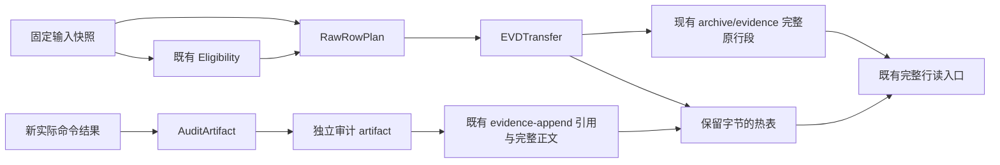

# FIX-448：无损证据热表瘦身设计（待独立设计审查）

- 日期：2026-10-20；角色：Architect；需求源：machine-signal，既有 0.99.0 范围（TRIAGE-FIX-448、REVIEW-REL-102-R2 P3-2、DEC-358①）。
- 状态：**PROPOSED / 容量验收 BLOCKED / 独立审查 PENDING / 未授权实施**。本文提出可实施边界，不是已采纳 ADR，不是迁移记录，也不是 28s PASS 证据。
- 本次唯一交付写面：本文件；新取证写入 `.codex-sandbox/FIX-448/design-recovery-20261020/`。旧 `design-r0`、治理热表、历史 cold、索引、refs、产品、hooks 均未修改；未提交、推送、实际迁移或安装。
- 标签：**SOURCE** = 本次源码/保存快照/上游明确指令可复查事实；**PROPOSED** = 供裁决和独立审查的设计；**NOT_RUN** = 未执行的实现、迁移、测试或性能验收。字节数是 UTF-8 原文件物理字节，KB 门按十进制解释。

## 1. 结论与交付边界

**当前无法在保留 FIX-444/445 暂停、missing fail-closed、完整原证据及 650,000 B 原门的条件下，仅靠普通归档实现目标。** 治理表头修复和FIX453真实闭环后的 **2026-10-20T08:31:48Z 最终读取**，热表为1,806,406 B。canonical分类中，FIX-444/445关联223条EVD为522,598 B，missing_task_ref的112条EVD为223,822 B；按原行位置取并集，335行、**746,420 B**。即假设其它所有行都可迁移，这个必须保留的集合仍超过容量门；自然关闭其它在途任务也不能单独解除该下限。全部active_task_ref另为405行861,976 B，本身也超门。[SOURCE：最终快照、`capacity-floor-final.json`；分类条件见 §4]

建议提交审查的是两段可独立验收的最小方案：

1. **完成任务的完整 EVD 分段归档**：沿用现有六条件分类、当前已发布保留窗，保留活动/未知/保留标记/重复行，使用 FIX-446 的 EVD 不覆写发布算法；新增的字节守恒与迁移恢复契约必须先审查。它能安全减少已证明可移出的部分，当前 EVD 候选净额只有 207,338 B，不能宣称完成容量目标。
2. **后续新证据的独立命令审计载荷**：命令原始结果放入有界、不可覆写的独立 artifact，新 EVD 保留完整的目标、用户影响、结论、关键事实和来源引用。只控制以后增长；历史机录原文、operation、report pin 保持原样，当前可计入的历史减量为 **0 B**。

它们都不改变冻结的 commit-msg/source 判断语义。对于“活动 EVD 主体改为索引/指针”的更大结构切换，必须另有明确范围裁决及消费者审查；本票不能顺带恢复 FIX-445。§11 给出三条决策路径及自然闭环后的重测条件。

本设计不把失败的容量目标改名为完成。若选择维持现有暂停边界，FIX-448 的阶段性设计可以交付，但“热表 <650,000 B 且 28s PASS”的原验收仍为 BLOCKED；Coordinator 应依据独立评审和明确裁决决定后续范围。

## 2. 目标、约束与评估标准

### 2.1 需求到设计映射

| 需求 | 来源/优先级 | 设计措施 | 验收事实 |
|---|---|---|---|
| 热 evidence <650,000 B，28s 消除 ERROR | FIX-448，P2 machine-signal | 迁移前后按原始 bytes 计算净收益；保留原 schema | 当前 BLOCKED，不能通过删日志、改门或错误完成状态实现 |
| 完整事实、历史不覆写、活动可达 | 用户质量 P1/P3/P7；FIX-446/DEC-350~352 | 原行字节切片、内容摘要、不可覆写发布、读回、来源位置与重复实例保全 | §8/§10 验证矩阵 |
| 不恢复 FIX-444/445，不改它们的 source 语义 | DEC-342、DEC-358①；本次任务约束 | 暂停任务全部关联 EVD/REVIEW 留热；hooks、engine/registry 实施本次零写入 | 任何引用化变更必须独立授权 |
| 消费者兼容且职责清晰 | D1~D4 | canonical classifier、既有读入口、独立审计载荷、迁移协调层分责 | §4 消费者矩阵；§7 无循环依赖 |
| 并发、中断、回滚不丢数据 | P4/P7 | 一致性快照、锁/CAS、archive-first、阶段恢复、非覆盖回滚 | 所有故障点 fixture NOT_RUN |
| bounded 读取，不用体积转移冒充成本消除 | 既有 28s/FEAT-076 三轨语义 | 热字节、全库完整性、全量增长分别报告；分页/明确资源拒绝 | 不能把 cold 总量、索引开销或未读内容隐藏 |

评估候选前先固定标准：①旧事实字节与机录真实性；②当前消费者兼容性；③实际热字节净收益；④暂停与既有授权边界；⑤崩溃/并发可恢复性；⑥最小产品面与维护成本；⑦明确的终态验收。减少一个文件大小而改变判定语义，不算通过标准①②。

### 2.2 原容量门含义

`core/architecture-health.json:77` 的 evidence override 为 warn=400,000/error=650,000；`verify_workflow.py:21181` 在 `count >= error` 时给 ERROR，因此目标必须 **<650,000 B**。`check_governance_data_size:21741` 直接对宿主热文件 `stat().st_size`；随后 `layer_stats()` 只补充 hot/cold/total 信息，不能让热文件超门变 PASS。

因此“<650,000 B”只证明 ERROR 面消除；400,000~649,999 B 仍可能有 WARN。最终必须记录实际 28s 命令输出，不能用“移出了若干行”推导整个健康状态 PASS，更不能将本次 Coordinator 披露的 full 健康 42 issues 非 PASS 改写为通过。本次没有重复跑 full 健康。[SOURCE / NOT_RUN]

## 3. 取证时点、完整性与容量算术

### 3.1 已保存证据复用，不重跑旧扫描

旧取证目录：`.codex-sandbox/FIX-448/design-r0/`。先读并复用 `measure.py`、`scan.json`、`metrics.json`、两份原文件快照；本次校验其 hash，未覆写、未重新执行 `measure.py`。

| 项 | 10/19 保存快照 S0 | 10/20 表头修复前 S1 | 10/20 最终快照 S2 |
|---|---:|---:|---:|
| evidence读取UTC | 11:25:53.345917Z | 08:21:54.884634Z | **08:31:48.068399Z** |
| evidence bytes | 1,752,123 | 1,787,003 | **1,806,406** |
| EVD行/bytes | 824 / 1,578,750 | 841 / 1,613,630 | **849 / 1,631,901** |
| REVIEW行/bytes | 190 / 125,999 | 190 / 125,999 | 192 / 126,805 |
| TRIAGE行/bytes | 60 / 20,636 | 60 / 20,636 | 60 / 20,636 |
| RECO行/bytes | 64 / 21,321 | 64 / 21,321 | 65 / 21,641 |
| 非上述行bytes | 5,417 | 5,417 | 5,423 |
| plan bytes | 230,280 | 230,280 | **230,272** |

旧 evidence SHA-256：`11634aa37d555c82654fdc00838d2cca74434396602cf51ce25faa08645572a8`。

S1 evidence SHA-256：`83e6d941fa48ab6f2d093e3966c670ae617b0eb5fc6eafc2df727c516be02119`。

S2 evidence SHA-256：`b4f3573e8617a9c952c749b3d95bcf8b9b93464649dc46270204fc88dfd5d4c4`。

S0/S1 plan SHA-256相同：`bae7eee7518b7ecc0b0fca0af875522e6582436825b9c10576ac4c0788979636`。S2 plan SHA-256：`2937e39716c144fd16495bdae4f61adcd65b9a43902ed5ddedf017e0c47c0983`；读取UTC为2026-10-20T08:31:48.068906Z。每个新输入各连续读取两次相等；这保证各自快照一致，**不声称两个文件具有跨文件事务快照**。后续实际迁移还必须在锁内重新校验两者及分类上下文。

S0→S1差额+34,880 B/+17 EVD；S1→S2差额+19,403 B/+8 EVD、+2 REVIEW、+1 RECO及6 B非行族文字。Coordinator在期间真实关闭FIX453、机录RECO，并将治理实例优先级表第二列表头`任务 ID`修为canonical `ID`；保存的`plan-header-final.diff`同时证明表头和FIX453状态/operation变更，零产品源码变更。该表头影响archive分类上下文对新任务表的识别，不能把S1的missing数量继续当当前事实。

因此仅在获知该事实变更后做了一次必要热面差分重测，S0/S1原快照、分类及hash均保留。S2的missing EVD从S1的374/620,165 B变成112/223,822 B；.99乐观EVD候选从139/236,412 B变成274/437,549 B。这是事实/识别边界改变，不是偷偷归档或把missing默认完成。本文“当前/最终”统一绑定S2；后续并发追加不被误报为损坏。

### 3.2 canonical 分类与不应误用的上界

新测量仅对已读取的热快照做有限分类，使用现有 `archive.scan_row_families`；没有进行第二次全仓扫描。`.98` 是已发布版本上界；`.99` 仅作宽窗乐观比较，不代表未发布周期获得归档授权或所有保留窗条件成立。

| 方法/时点 | 可移行/原行 bytes | 剩余热 bytes | 解释 |
|---|---:|---:|---|
| 旧快照 .99 四族 canonical 候选 | EVD139/236,412；其它45/16,318 | 1,499,393 | SOURCE；候选不等于执行授权 |
| S1 .98 EVD-only候选（历史时点） | 120 / 207,338 | 1,579,665 | 保留旧统计，不作为最终剩余值 |
| S1 .99 四族乐观上界（历史时点） | 184 / 252,730 | 1,534,273 | 表头/状态修复前 |
| S2 .98 **EVD-only** canonical候选 | 120 / 207,338 | **1,599,068** | SOURCE；最接近现有FIX446已硬化写面 |
| S2 .98 四族canonical候选合计 | 151 / 218,494 | **1,587,912** | SOURCE；额外11,156 B非EVD不享同等保护 |
| S2 .99 EVD-only乐观上界 | 274 / 437,549 | 1,368,857 | SOURCE；不是发布窗裁决 |
| S2 .99 四族乐观上界 | 331 / 458,277 | **1,348,129** | SOURCE；仍比650,000 B门多698,129 B |
| 旧快照：无热任务关联、无启发keep的 EVD 全部分段 | 383 / 620,313 | 1,131,810 | 仅结构分段上界；包含 missing 等，**不等于可归档** |
| S1：同样的宽松分段上界 | 400 / 655,193 | 1,131,810 | 表头修复前反证，非最终集合 |
| S2：同样的宽松分段上界 | 138 / 258,850 | **1,547,556** | 只是“全部搬走仍不够”的反证，不是迁移名单 |

四族 .98 组成：EVD207,338 + REVIEW6,700 + RECO1,612 + TRIAGE2,844 =218,494 B。这里计算的是热文件移出的原行净额；cold header、journal、索引、载荷保存额外增加总库大小，不能把它们计为全库节省。实际迁移若保留分配高水位行、增加说明文字，热净额还要相应扣减。

保存的“无热关联”测量采用额外启发 keep 正则；它不同于 canonical keep 字典，更没有证明 missing/duplicate/unknown 的生命周期。它只支撑容量反证，禁止作为写入器 candidacy。

### 3.3 两个层次的下限与结构化收益边界

1. **保留所有热任务完整EVD的模型下限**：S0/S1均438行951,230 B；S2修复上下文后为708行**1,365,844 B**。这是保守工作集模型，包含已完成但仍热的任务；现有FIX235允许已完成热任务在条件满足时移出，不能把它伪称为所有合法方案都不可突破的绝对下限。
2. **当前规则下的强阻断**：冻结FIX444/445关联223行522,598 B（222 active、1 explicit_keep）与S2 missing112行223,822 B并集为335行**746,420 B**。没有显式恢复、可信生命周期事实补齐或经授权的全消费者读契约变更，普通归档必须保留。`capacity-floor-final.json`给出实际并集；S1的`capacity-floor.json`597行1,142,763 B只证明旧时点，不再用于当前结论。另S2全部active405行861,976 B已经超门。

原始旧 EVD 的 cell bytes 主要是 description464,101、basis800,174、artifacts167,061；它们含大量实质事实，不是可直接删除的“冗余审计字串”。为了检查“只把 basis 改索引就足够”的说法，本次另做**纯算术模型**：只在严格10列的机器EVD上，将整个basis cell长度替换为96 B的 `事实依据：audit-ref sha256:<64hex>` 长度；没有写出替换后的机录或热表。

| S2最终快照算术模型 | 热文件结果 |
|---|---:|
| 694条严格机器行的完整basis外置，省584,808 B | 1,221,598 B |
| 再假定S2宽松无热关联集合全移出，剩余行basis再省583,850 B | **963,706 B** |

963,706 B还未计入新定位索引/文字，并仍超门。S1相同宽松模型曾为706,524 B，差异来自任务上下文修复后更多行需保留热关联，不能混用。该模型外置的是**完整事实依据**，不是已识别的独立命令审计字段；不能把584,808 B冒报为“命令归一化实际收益”。冻结hook不会解引用该指针，原operation payload也被改变，因此这个模型本身不可实施。真正兼容的“以后新审计独立记录”对现有历史热量已证明收益为 **0 B**；未来节省需逐条实测。

### 3.4 取证可复查性

新scratch保留S1的current snapshot/metrics/scans/floor；另有S2的`evidence.final.snapshot.md`、`plan.final.snapshot.md`、`metrics-final.json`、`scan-final-through098.json`、`scan-final-through099-bound.json`、`capacity-floor-final.json`和`plan-header-final.diff`。共用测量程序`measure_current.py`仅以不同输出前缀新增，未覆盖既有快照；另有`source-anchors.json`、`command-audit.jsonl`。

源码以工作树读取为准；当时 HEAD=`e28e67c6fb3c3c15fda278d179bf8abc9daae8bd`，`source-anchors.json` 逐文件保存长度及SHA-256。它不声称暂停中的 hook 工作树内容已提交、可发布或来源验证已经成立。旧五个取证文件的完整hash在 `metrics-current.json.old_saved_hash_verification`。

所有 Python 调用的 HOME/USERPROFILE/APPDATA/LOCALAPPDATA/DSH_HOME/TEMP/TMP/cache 指向本次 scratch；`-B`/禁bytecode生效。隔离命令日志包含实际UTC、绑定参数、执行代码、批次exit及影响声明。早期日志的 `argv` 曾记录 launcher 模板，已追加 `audit_clarification` 更正为实际 PowerShell call-operator 调用；不把模板冒充观测到的进程命令行。个别定位 `rg` 命令遇到不存在的猜测路径，错误在工具输出可见，随后按实际路径读取；批次exit不是每个rg的独立exit。初始角色/计划读取仅为只读 shell builtins。本次没有联网、安装、真实HOME或宿主profile/session访问。

## 4. 实际消费者与写入边界

下列路径均相对于仓库。`infra/` 简写为 `skills/software-project-governance/infra/`。这不是“存在统一入口所以都兼容”的推断；热读取者仍有真实独立语义。

| 面 | SOURCE 锚点及真实行为 | 本设计必须保留/变更边界 |
|---|---|---|
| 通用 EVD 查询/证据完整性 | `verify_workflow.py:10044/10066` 汇总热文件和cold EVD；`checks/evidence_domain.py:246` 使用GovernanceDataSource | 完整原行放在 `archive/evidence/*.md` 可继续按Task/EVD查；裸blob或新目录不会自动可见 |
| 四族完整行读取 | `GovernanceDataSource.get_all_family_rows:10153`；cold按文件名排序，完整line+file+source返回 | 保持family prefix、ID、Task列及原行；不只给摘要。改变位置/顺序会影响最新项判断，不能随意合并重排 |
| 其它完整证据查询 | `verify_workflow.py:18551` 对cold EVD逐行yield，无EVD档案才fallback全文 | 分段必须是完整行；未知/受损行不能因提取器没识别就丢弃 |
| 归档分类 | `archive_verdicts.py:248` 六条件；`:162` hot_tasks/hot_anomalies；`archive.py:519/693` archived+completed-hot映射 | missing/active/ambiguous/layout异常/版本不明/重复/keep继续保留。已发布版本不等于任务完成；所有gating refs均需成立 |
| index/完整性 | `archive_indexing.py:218/251/512` 四族不同shape提取，异常档案另登记；`verify_workflow.py:19505` 检查index及守恒/trigger-gap | 保留index原语义，新增manifest做字节证明；原Check27不是字节守恒证明。不能仅放新目录而不接入查询与索引 |
| 普通 EVD 写入 | `governance_store.py:1021/1042/1157` 10列、目标≥30字、事实basis非空、用户影响镜像；`:1198` fingerprint覆盖原描述/basis/artifacts等；`:1222` TargetLock、字节revision、原子写、机录后验证 | 新EVD骨架保持；不能事后改原机录来伪造同op的新载荷。`governance-store-ops.json`是EVD操作账本，不能把它当可删除日志 |
| EVD operation恢复/ID分配 | `governance_store.py:1256` ledger miss时只查热文本marker；`:738` max(hot)+1再检查archive碰撞 | 迁移不得搬走未收妥receipt的pending行；已迁移marker不可被当作从未发生而重写。现有分配器不是global max+1，必要时保留数值分配高水位原行，或另审分配契约；不偷改 |
| REVIEW 写入/信任链 | `review_record.py:600/888/1002` report字节hash、commit/worktree pin、机器行11列尾；`:1015`直接append热表 | 不重新渲染旧review、不缩hash、不改round/actor/result；旧报告和账本pin原位保全。该append未使用EVD的TargetLock，迁移窗口必须协调或暂停它 |
| write-guard/ops | `verify_workflow.py:24624/24630/24675/24692` row digest、按行号识别ops receipts及机录marker；`write_guard_state.py:288/786` EVD/REVIEW分族；`task_row_update.py:771/1278` receipt含输入/前后行hash | EVD与REVIEW受管控，TRIAGE/RECO不能假装得到同等凭证保护；`.ops.jsonl`属于Task行写入器，不是重复EVD可删副本；不能重排/压缩receipt或伪造credential、baseline consume |
| Review闭环Check30 | `checks/review_domain.py:3041` 热+cold REVIEW合并但保留hot/cold channel；`:3480` provenance从热表及review文件读取 | 归档可能改变cold历史分支，不能只验证记录总数；活动票review及其失败链继续热可达，closed票逐票验证合法历史分支 |
| M5运行语料 | `checks/review_domain.py:1387/1445` 自动语料仅直接读热表含事实依据的行 | 把活动basis指针化会改变扫描内容，可能误清问题；保持活动全文并比较违规指纹，不能把少扫描当修复 |
| 目标/用户影响 | `verify_workflow.py:13608/13705/13799` 热EVD，终态豁免需真实状态；用户影响latest-field-wins；writer镜像同字段规则 | 目标/四子字段/破坏性迁移指南留在新完整EVD正文；活动证据不截断为“详见”。次序和旧坏行不能用归档绕过 |
| triage/R1/推荐 | `checks/triage_domain.py:307/531` 热表查最早产品日期及R1留痕；`task_priority.py:2412` 热证据判重；`verify_workflow.py:23945`推荐写面 | 活动首条、最新条及中间失败证据都保留；只保留latest行不能证明这些判断相同 |
| commit hooks | `hooks/pre-commit:32`读热文件；`hooks/commit-msg:29/50/1075/1115/1139/1198/1258`只取热表EVD全文、REVIEW批准尾等 | 没有cold resolver；迁移已完成且不会继续提交的票可保持当前ticket语义。票重开需先恢复其完整可达集合；移动活动全文需另审hook读契约，当前禁止 |
| 冻结source验证 | `hooks/commit-msg:475`仅识别docs/reviews及.governance/incidents/reports引用，`:493/497`补Task incident后截32文件；`:508`跳过evidence-log；`:529`全文UTF-8读取；`:121`要求record/id/双UTC/字段对应 | hash本身不是来源凭证，新“audit-ref”目录不会自动可信；32文件裁剪/全文read也不构成已证明资源有界。FIX445来源NOT_ESTABLISHED/暂停历史不因本设计改变；不借新resolver修它 |
| 28s/quickscan | `verify_workflow.py:21741`物理热文件门+三轨信息；`quickscan_registry.py:525`28s依赖声明 | 路径迁移不能让quickscan因漏依赖给假新鲜；若未来新增manifest/载荷参与判定需显式登记依赖。当前零registry改动 |
| 旧迁移/回滚工具 | `archive_entity_migration.py:426` one-shot EVD独占发布+原子热写；非EVD`:463`明确保持legacy写法；`archive_migration_engine.py:1279`resumable走另一apply；`archive_entity_migration.py:598`旧回滚追加行再unlinkcold | FIX446保护仅覆盖获裁决的EVD腿。不能声称所有族/resumable等价；不把旧rollback当不可变历史方案默认回滚器 |

关键源码约束：FIX-446的 `_write_archive_file_never_overwrite:442` 使用 `O_CREAT|O_EXCL`，先写完整payload并flush/fsync；EEXIST须验证真实条目身份、字节与持久化，外来内容/交换/非普通文件/读写失败拒绝。Windows目录fsync只是best-effort，不能夸称断电后目录条目绝对持久。必须保持该算法，不能用“唯一文件名+os.replace”替代它。[SOURCE]

resumable `archive_migration_engine.py:1298~1313` 为exists/hash判断再atomic-write，和上述独占创建的竞态/范围不同；非EVD legacy的同名覆盖行为还被 `tests/test_archive.py:6785` 钉住。本设计只揭示调用边界，不在本票暗改这些语义；若后续要统一保护，先取得新的明确设计裁决、独立审查和回归证据。

## 5. 候选方案比较

### A. 仅按证明完成的任务归档完整行（现有读契约）

**数据**：EVD原行分段放在现有 `archive/evidence/`，原Task/ID/列/事实不变，原index可定位；active/missing/unknown行仍热。

**兼容性**：通用查询、四族读入口、完整性及已关闭历史review支持此布局；热hook/目标/用户影响保持活动全文。闭合票若仍有待提交代码、未完成review/operation恢复或重开需求，不是这个窗口的可迁移对象。

**收益**：当前 .98 EVD120行207,338 B；即四族218,494 B全计仍剩1,587,912 B。全库不减量，只改变层位置。旧字节之外增加manifest/index/header开销；本次未实施，净收益是移出热原行算术。

**最小产品面**：无需改分类词表、hook、source、registry或消费者schema。若只调用现有one-shot EVD，使用其真实保护范围并披露EOL/并发/恢复局限；要满足本文更强的字节级/可恢复契约，需要EVD-only迁移协调层及fixture，不等于已存在的能力。§7~§10是该增强的可审规范。

**取舍**：推荐作为最小迁移基础，但**不能单独满足当前容量验收**。自然闭环仍须重新做容量下限，不能预先承诺发版后自然小于650KB。

### B. 完整证据分段读取，热文件只保留活动集合或索引

分为两个真实不同的范围：

- B1：仅将无热任务关联的原行作为独立存储段，保留其missing/unknown状态，不宣布“已归档完成”。S2即使宽松移出全部138行258,850 B，仍余1,547,556 B；且需要新状态/索引来区分“存储层”与“任务生命周期”，现有archive目录本身表达cold语义，不能直接混用。
- B2：把包括active/missing的完整原证据存入不可变段，热文件成为可定位索引或受管投影。理论上热目录可足够小，但所有按热全文判断的消费者必须改为读取完整逻辑证据集合；只改`GovernanceDataSource`远远不够。

**真实消费者适配范围**：EVD查询/index/完整性、write-guard逻辑对象身份、append/ID与operation恢复、Review30/30c及M5、目标/用户影响/triage/R1、hook完整Task读取、source候选文件与资源界、quickscan依赖、28s逻辑工作集成本统计。新接口必须原样返回每个实例的完整bytes与出处，不能用摘要代替。

**收益与代价**：B1实际反证已给；B2没有在当前约束下合法的可承诺热byte净额。新索引也占热面，若只是把无限工作集藏在cold再每次全读，28s物理数值变小但成本问题未解决。需要按Task查询、offset/length及页界、拒绝/续页语义，并证明查不到任何行不会给PASS。

**权限**：B2会触及被冻结的hook/source读契约，当前 **BLOCKED**；B1虽不必移活动EVD，也需要生命周期模型新增，当前收益不足、不选为首版。不得借FIX448重新实现FIX445的source API或接纳其未成立来源。

### C. 规范化独立命令审计载荷，新 EVD 引用完整载荷

**C1 向前生效，兼容现有消费者**：命令原机输出只保存一份独立artifact；新EVD行仍有完整事实性摘要、目标对齐、用户影响四子字段、实际结论、必要引用。`governance-store evidence-append`已有artifacts/typed refs输入，不要求新EVD schema，也不要求source解引用才能保留其正文的必要事实。不存在原始输出就拒绝生成“已验证”记录；无退出码/无运行时点则标NOT_RUN。

**C2 追溯改写历史basis/description**：即使原文移到blob，原EVD payload被改、operation指纹和write-guard对象发生变化、hook和M5见不到全文、引用路径未必匹配source白名单；拒绝将其混入C1。§3.3最终快照仅basis整体外置的极宽松算术组合仍963,706 B，不能据此虚报完成。

**收益**：C1现有历史0 B；对未来每次命令可避免把同一完整stdout/审计JSON在EVD重复内联，数值由新旧渲染对照度量。原始命令数据总库仍保留；每条新audit有元数据和索引开销，不自动去重原始证据。

**最小产品面**：首先可通过现有artifacts/refs和caller生成规范审计记录试行，不改writer/hook；如需要标准命令记录器，新增一个有界审计artifact组件和测试，接口见§7。任何让“引用载荷”替代EVD必需事实的reader改动均退回B2范围，需另授权。

**取舍**：推荐C1作为增长治理与A组合；拒绝C2历史改写。它是兼容的具体方案，但不是当前650KB缺口的解药。

### 候选结论

| 标准 | A 完成任务完整行 | B 全文分段+逻辑resolver | C1 新命令审计独立 |
|---|---|---|---|
| 原证据保真 | 可满足，需raw字节契约 | 可满足，需全实例manifest | 可满足；历史零改写 |
| 冻结hook兼容 | 活动全文保留时兼容 | B2不兼容，当前不得实施 | 必需正文留热时兼容 |
| 当前可证明净额 | EVD207,338 B候选；受额外pin扣减 | B1宽松上界258,850 B仍不足；B2未获范围 | 0 B历史；未来逐条实测 |
| 最小变更 | EVD-only迁移协调与验证；不扩四族硬化 | 广泛读写入口，成本最高 | caller/artifact规范；可不改既有schema |
| 当前650KB结论 | BLOCKED | B1不足/B2权限BLOCKED | BLOCKED |

## 6. 建议首版范围及不变量

**PROPOSED**：首版采用A的完整行物理分段与C1的新增审计，不把二者合并成“自动完成FIX448”。先独立审查本设计及容量阻断，再由Coordinator裁决范围。

不变量：

- I1：原EVD/REVIEW实例字节、旧cold、原始审计、report文件与pin、operation/receipt从不被本迁移改写或删减。实例以“输入文件digest+byte range+行digest”标识，ID相同不等于同一实例。
- I2：只有canonical六条件通过、发布窗及保留策略成立、无待完成operation/review/提交、非暂停/非keep的实例才可移。unknown、missing、malformed、重复实例留在原热文件；manifest记录保留理由，未识别的非表格字节逐段保留。
- I3：所有活动任务的完整有序证据集合及失败历史保持热可达。不能只留最新行，不能用摘要/新正面EVD抵消旧失败语料。
- I4：cold先完整发布和验证，hot后CAS替换，最后索引/事务finalize；任何缺件、读取错误、身份交换、输入漂移都不能被当作已完成或空集合PASS。
- I5：保持FIX446 EVD独占发布算法及其fsync/身份检查；不复用存在then replace给cold覆盖，不扩其现有保护范围的历史声明。
- I6：650,000 B和400,000 B门不变；原full健康问题、FIX444/445暂停与source NOT_ESTABLISHED不变。完成容量前没有整体PASS声明。
- I7：现有writer操作记录保留；新迁移使用独立transaction_id，不冒用旧`op-*`作为新写入授权，不补造“历史命令已执行”记录。

## 7. 模块、接口及数据模型（PROPOSED）

### 7.1 最小模块划分

| 模块 | 单一职责 | 复用/新增边界 |
|---|---|---|
| Eligibility | 对固定输入给出canonical行判定和理由 | 复用archive_verdicts；不新增另一套active/missing词表 |
| RawRowPlan | 将已判定实例映射到原始byte slices并生成有序迁移计划 | 新增小组件；不重新渲染旧行，不给语义完成状态 |
| EVDTransfer | 负责计划的锁、cold独占发布、hot CAS和阶段恢复 | 复用FIX446发布原语；若增强现有one-shot/resumable须单独明示裁决，不默改共享腿 |
| AuditArtifact | 对新实际命令的原始输出及身份元数据做不可覆写保存 | 新增可选组件或caller约定；不解析/授信旧EVD，不修改source语义 |
| ExistingReaders | 按原入口查热与现有cold完整行 | 首版不增resolver；B2才改变其契约 |



依赖从输入/分类到计划到事务再到存储，无读写组件反向依赖分类；AuditArtifact不调用hook/source、分类器不依赖事务、旧读入口不依赖迁移journal。该设计无循环依赖；首版不引入服务、数据库或另一权威账本。

### 7.2 接口契约

以下是待实现接口，不声称当前CLI已支持；不在本次注册新命令。

`plan_evd_compaction(input, policy) -> Plan | Refusal`

- 输入：固定hot原始bytes/sha/size、plan原始bytes/sha、分类上下文摘要（archive task映射/registry/发布窗事实的摘要）、目标版本窗、每段byte/row上限、目标热byte、pin理由。
- 输出：`schema_version`、`transaction_id`、输入pins、候选实例和保留实例、原byte range/row hash/family/ID/Task refs/canonical reason、有序segment组成、hot_after_sha/size、预计额外cold/index/journal bytes、capacity状态。候选不产生副作用。
- 校验：offset不重叠且覆盖证明；byte slice解码与classifier所见行一致；无源hash漂移；无法映射的行留热。容量不可达返回计划和`capacity_status=blocked`，不是丢弃保留项或降低门。

`apply_evd_plan(plan, expected_inputs, transaction_id) -> Receipt | Refusal`

- 输入：已审且实际获授权的计划、当前输入pins、独立transaction_id；不是仅传Task ID的隐式全库清理。
- 输出：状态`prepared/cold_verified/hot_committed/indexed/finalized`之一、原/后digest、各新segment大小/hash/实例数、实际热净额、索引验证及恢复义务、审计起止UTC与实际命令/exit。
- 失败码：`input_diverged`、`classification_context_changed`、`pending_writer_operation`、`writer_not_quiescent`、`archive_target_conflict`、`identity_changed`、`byte_conservation_failed`、`resource_limit`、`index_incomplete`、`recovery_conflict`。拒绝不能以空候选成功替代。

`recover_evd_transfer(transaction_id, expected_world) -> Receipt | Refusal`

- 只按已pin输入、staged slices与真实文件判断世界，不信journal单一状态。before/post两者都不匹配即`recovery_conflict`；不得自动删journal重新pin当前文件。
- finalized后有新append是合法后续世界，不能用旧postimage覆盖它。需要新事务或append感知的回滚计划，旧事务仍可审计。

`withdraw_new_segments(transaction_id, source_identity_pins, destination_root) -> WithdrawalReceipt | Refusal`

- 仅适用于本事务独占创建、尚处恢复/撤销窗口的新segment；任何事务开始前已存在的cold（包括碰巧同payload的文件）不进入此写面。输入需证明创建所有权、当前身份、精确bytes/hash和目标根约束，不能只看文件名或ID。
- 维护窗口内将这些新segment以**同卷原子、目标存在即拒绝的no-replace rename**转入事务专属保全目录，记录完整原/新路径映射和hash，字节仍保存。不能调用会覆盖目标的通用rename/replace；平台无可用no-replace原语则返回`withdrawal_unsupported`，选择前向恢复，不采用copy后盲删源的替代。
- 该接口是显式的PROPOSED新恢复能力，不是当前工具已有功能。V4/V9必须覆盖权限、路径交换、同名目标、跨卷和中断；没有该能力时只允许plan或前向resume，不能自动调用旧unlink回滚。

`record_command_audit(record, output_artifacts) -> AuditRef | Refusal`

- 新record字段：`schema_version`、独立`command_record_id`、task关联、实际argv数组、工作目录、真实UTC起止（保留分数秒精度）、exit_code、执行/NOT_RUN状态、读写影响、隔离路径、stdout/stderr artifact path/byte/hash、截断/缺失状态。
- `command_record_id`不是governance-store的授权operation_id。只有真正在本次执行的命令能有已执行/退出码；NOT_RUN不得带虚构exit=0。
- 外置输出字节原样保存，路径约束在授权根内，先lstat/containment与普通文件检查；自描述hash用于完整性，不自动成为source可信凭证。若传给冻结hook的引用，仍只适用现有读取/凭证规则；不向新目录授信。
- 新EVD保留完整必要正文，artifacts/typed refs指向真实存在载荷。兼容现有writer前置schema验证，不能把“详见hash”填成空洞事实basis。

### 7.3 迁移manifest与原始字节模型

```json
{
  "schema_version": 1,
  "transaction_id": "new-transfer-id",
  "input": {"hot_sha256": "64hex", "hot_bytes": 1806406,
            "plan_sha256": "64hex", "classification_context_sha256": "64hex"},
  "instances": [{"source_sha256": "64hex", "byte_offset": 0, "byte_length": 1,
                 "row_sha256": "64hex", "family": "EVD", "row_id": "opaque-id",
                 "task_refs": [], "decision": "retain-or-move", "reason": "canonical-reason"}],
  "outputs": {"hot_after_sha256": "64hex", "hot_after_bytes": 0,
              "segments": [{"relative_path": "archive/evidence/new-increment.md",
                            "bytes": 0, "sha256": "64hex", "ordered_instances": []}]},
  "phase": "prepared"
}
```

以上offset/length为类型示例，非实际迁移计划。所有数字必须从真bytes生成。原文件以二进制读取；保留每行LF/CRLF、BOM、空行、引文和未知片段。解码视图仅用于分类；manifest使用原byte offsets，不使用字符索引替代。归档新增header可以规范化，但它与原payload字节范围必须分开，保真校验只比较payload的精确slices。

既有 `read_text`/`split("\n")`/join 写法可能规范化原CRLF；本次快照测量不能证明所有用户项目EOL相同，因此不能把“当前一轮fixture没变化”扩称通用byte保真。实现须提供LF/CRLF/BOM/末尾无换行正例，不靠全仓renormalize。

## 8. 迁移、并发、恢复与回滚（PROPOSED / NOT_RUN）

### 8.1 应用顺序

1. **Plan**：从授权一致性快照生成canonical候选；暂停票、未完成operation、最新分配高水位、仍需正常提交/审查的票，以及未知行均pin并解释。计算真实hot_after及总存储增长；不达容量也如实返回。
2. **Quiesce+revalidate**：迁移取得与EVD writer相同的hot TargetLock，复核hot/plan/分类上下文pins。`review_record`直接append、triage/reco写面、旧迁移与人工编辑不全受同锁，必须有明确短冻结窗口或补齐共享锁契约；仅持有文件锁不等于全写面互斥。不能停掉其他并发Agent后宣称分布式安全。
3. **Prepared**：独占创建本事务stage/manifest，保存原行slices与before bytes备份及hash；落盘后重新读回。该stage是新事务专属，原cold不加入可写集合。
4. **Publish cold**：每段使用FIX446同一独占创建/真实entry验证/fsync算法。原有目标同名但不完全匹配该事务payload、类型、身份/持久化均拒绝，不覆写、不按hash白名单放行、不自行删除半件。
5. **Verify cold**：逐slice hash、bytes及实例数一致；原文件分割可逆重组后整体digest等于before。索引的EVD/Task映射与完整查询能读回相同实例；正则未识别的片段仍在hot。
6. **Commit hot**：锁内再比before，保证无append/review并发遗漏；只写预先pin的hot_after，以temp+fsync+atomic replace保留未迁移bytes。hot不匹配before/post之一则拒绝，不合并猜测。plan或上下文漂移同样拒绝。
7. **Index/finalize**：生成新index和manifest状态，验证每新segment的查询定位及既有索引不丢失；pending-index恢复义务未消除前不得宣称迁移完成。旧cold仍原位，旧index的读路径一直能访问旧档案。
8. **Post-check**：读回三轨指标、guard/review/目标用户影响/triage/ID append兼容性；以fixture和获授权的真实检查确认。实际append smoke应在副本执行，不能为了验收新增虚假治理EVD。

多文件更新没有天然原子事务。已有reader会glob所有cold，因此cold发布后hot提交前可见暂时重复；首版选择受控短冻结窗口，期间不运行会据重复作决定的消费者，结束必须验证唯一/完整集合。若要求任意时刻在线一致读，需要generation manifest+全reader按generation选择，属于B2的额外范围，不能说只加journal就已解决。

### 8.2 关键中断世界

| 中断/竞态 | 必须保留的世界 | 恢复行为 |
|---|---|---|
| prepared前崩溃 | hot原样、old cold原样 | 无完成声明；不存在有效plan不启动删除 |
| cold创建半件、fsync失败或磁盘满 | hot原样；半件保留以供核对 | fail-loud；不得把存在当成功，不自动清理外来/半件 |
| cold完整、hot未写 | hot全量+cold新副本 | 恢复按transaction payload/身份核验；只能完成同一已pin计划或保全退出 |
| hot写前append或review追加 | 现hot保留新增行 | CAS拒绝；旧plan不覆盖新bytes，重取快照生成新事务 |
| hot已写、journal/index未完成 | hot_after+完整cold+staged原slices | 校验真实postimage后完成索引/finalize；不能从缩小后的hot重算已移内容 |
| finalized后正常追加 | postimage+合法后续写入 | 不用旧digest强行回滚；追加感知恢复需新计划，否则拒绝 |
| cold同名并发赢家/路径替换/非普通文件 | 赢家或原条目字节不变 | 独占创建/身份检查拒绝，禁止exists+replace覆盖 |
| plan/archived task映射变更、任务重开 | 当前事实与全部证据保全 | classified pins变化即拒绝，重新规划；完成状态不得从旧journal继承 |
| index缺失/读错/损坏 | 文件和原payload仍在 | `index_incomplete`阻断完成；修复索引，不把未检出行解释为无证据 |

### 8.3 回滚契约

旧 `_rollback_evidence_archive_impl` 会将所有族行追加回热表后unlink归档文件，不能满足本设计“保留cold历史”的要求。首版增强回滚须独立实现/获审，不直接调用旧工具消除失败。

- 未hot提交：hot原样；默认前向resume。若明确执行撤销，在维护窗口先用`withdraw_new_segments`保全本事务新段到既有reader不glob的事务保全目录，更新索引后解除窗口；manifest原件、stage及原有cold不改。能力不可用则保持窗口/返回未恢复，不让重复可见世界静默进入正常读取。
- hot已提交且没有后续写入：严格比较hot_after及当前cold/manifest，在维护窗口恢复before bytes并读回，再保全退出本事务新段、恢复原index可见集合；新增撤销receipt引用原manifest及保全位置，原件不覆盖。中断导致暂时重复或暂不可见均由before/post+各文件真实身份恢复，窗口解除前必须恢复完整唯一读取集合。原有cold从不移动/删除/改写。
- 有后续append/状态变化：禁止直接以备份覆盖当前文件。生成新反向计划，按实例插回需要行并保留全部后续bytes、顺序与operation证据；不能证明合并正确即`recovery_conflict`，停在可恢复世界。
- 任一路径不删/改原cold字节，不覆写原report/ops，不伪造guard基线消费。新段的保全退出须获明确回滚范围，只限本事务新建对象且保全全部bytes；所有权不能证明就拒绝。任务重开也要先完成完整历史可达性恢复，解决热/cold重复解释后再允许正常工作。

首版选择维护窗口+本事务新段保全退出，避免要求所有旧reader新增撤销schema；自动回滚不是实施前已有能力。独立评审须接受该新恢复写面并验证平台no-replace原语，否则只允许plan/前向resume。若未来要求无维护窗口、永不移动任何已发布新段的在线撤销，需要generation-reader额外范围；不能用未经定义的权威标记让旧reader自动忽略重复。

## 9. 资源界与非功能要求

| 非功能项 | PROPOSED 约束 | 失败/披露方式 |
|---|---|---|
| 热容量 | 物理hot <650,000；另报400,000 WARN线 | plan返回净额/差额；绝不截断到门下 |
| 计划资源 | 首版受控输入上限8 MiB；每段payload≤100,000 B、≤128行；最多128段；单原行≤100,000 B | 越界`resource_limit`，整行留热且列出；不截断或拆散一个原行 |
| 查询 | 现有cold完整行读仍可能全库全文扫描；按ID/Task定位可用index先缩小范围 | 不承诺已解决全库读放大；B2需流式/分页单独验收 |
| 新审计 | 单record JSON≤32 KiB；每stdout/stderr artifact≤1 MiB的首版预算；超限保留输出文件或显式拒绝入账 | 不能先截断原输出再报完整。资源预算不满足则NOT_RUN/未完成，不伪造完整source |
| 空间 | before备份+stage slices+新cold+hot temp+index/journal的实际预计bytes，再留25%余量 | 无空间即预检拒绝；不能为了腾空间删原cold/ops |
| 时间/锁 | fixture证明p95 plan≤2s、apply临界区≤5s的初始目标；锁等候≤10s，超时明确拒绝 | 性能数字均NOT_RUN，需实际平台证据才能成为SLO |
| 安全/权限 | 授权根内普通文件；realpath/identity检查；新cold exclusive-create；无网络/安装/宿主改动 | symlink/junction/identity变化拒绝，保全外来bytes |
| 可维护性 | 分类单源；不让查询、操作授信和存储投影互相兼任 | 不新增第二套完成词表，不扩大God Module |
| 可靠性 | archive-first、fsync、CAS；所有阶段可解释 | Windows目录持久化限制如实披露，不承诺跨平台绝对断电持久 |

100KB段等是首版设计预算，**不是已经跑过的性能结论，也不是改变原治理门**。当前849条EVD每条大小可在预算内并不证明未来输入一定如此。既有source `files[:32]`与其全文f.read不被本票改动；新载荷方案不能以超过该候选限额后静默未读仍称来源验证通过。

## 10. 可执行验证矩阵（全部实施验收 NOT_RUN）

设计阶段已执行的仅为resolve、governance-bootstrap、保存取证hash复查、热快照有限分类/算术和源码读取。未跑下列回归，不借旧测试存在声称新设计通过；无需为设计重复全pytest/full健康。

未来验证全部在授权scratch副本fixture内，HOME/USERPROFILE/APPDATA/LOCALAPPDATA/DSH_HOME/TEMP/TMP/cache指向fixture，禁真实profile与session。命令写实际UTC/argv/exit/影响，测试输出原样留存。

| ID | 执行入口/fixture | 必须证明的断言 |
|---|---|---|
| V1 分类同源 | `python -B -m pytest skills/software-project-governance/infra/tests/test_archive.py`；另补新计划器fixture | 完成/active/missing/ambiguous/keep/多Task/版本不明/duplicate/malformed/无Task日期窗完整正负集；dry-run与apply候选一致 |
| V2 字节守恒 | 新`test_evidence_compaction.py`（待实现） | LF/CRLF/BOM/末行无换行、原`\|`/Unicode、重复ID实例、未知段全部精确重构；逐slice hash+整体before hash一致；old cold hash恒等 |
| V3 FIX446守卫 | `test_archive.py -k 'never_overwrite or collision or fsync or foreign'`（完整命令前缀同V1） | 同范围再迁移新文件；相同/foreign/目录/symlink/大foreign/identity swap/Windows fsync拒绝；非EVD旧scope断言不被误改 |
| V4 崩溃恢复 | 新迁移事务fixture，在prepare/cold创建/flush/fsync/hot替换/index/finalize逐点故障注入 | 每世界至少一份完整数据；hot before或post可判；未完成不报成功；外来/半件不被清理；恢复幂等与冲突拒绝 |
| V5 并发写入 | 新fixture双进程EVD append、review_record append、两迁移同名、plan更改/任务重开 | writer窗口确实受控；CAS拒绝保留新增；cold赢家原bytes不变；没有丢review、无死锁、超时结构化 |
| V6 读者等价 | `test_evidence_layer.py`、`test_review_closure_legacy.py`、`test_change_triage.py`及新全实例对照 | Task→完整EVD集合、四族ID/行内容、Review结论/日期/channel、最早日期/R1/推荐判重前后符合预期；没有少读导致假PASS |
| V7 身份/机录 | `test_governance_store.py`、`test_review_record.py`、`test_review_machine_provenance.py`、`test_triage_write_guard.py` | 同op同payload replay；不同payload拒绝；原op/report/commit/worktree pins不变；pending marker迁移拒绝；高水位归档后append不碰撞或明确pin |
| V8 活动完整性/冻结hook | `test_pre_commit_review_evidence.py`及仓库现有真实bash hook回归入口，在副本调用canonical hook | 正/负事实源、目标、用户影响、肯定无依据/混合句、source读失败仍保留原阻断；迁移不改变FIX444/445语义；该族既有失败单列，不能预填green |
| V9 撤销/重开 | 新反向计划fixture | before恢复、后续append保全、cold不删、reader重复解释有明确权威；不匹配世界拒绝；未经复原的重开不被放行 |
| V10 资源/审计 | 新AuditArtifact及计划器fixture | 100KB单行/段、128段、8MiB输入、空文件/坏UTF-8/磁盘满/无权限/超时/大输出；超限非silent truncate；新审计NOT_RUN无exit造假 |
| V11 实际容量/完整性 | 副本上 `python -B skills/software-project-governance/infra/verify_workflow.py check-governance-data-size`、`check-archive-integrity`；再运行针对性goal/user-impact/review/guard命令 | 记录真实物理bytes/净额/索引与完整库hash；28s<650000才去ERROR，<400000才无该WARN；原既有失败与新增失败分开 |
| V12 迁移前后成本 | 相同副本、相同输入至少5次读/plan/apply抽样 | 报median/p95、临界区、文件数、最大读量、peak memory、总库增长；不以移出热表替代成本数据 |

完整套件/发布门应在实际产品实现及针对性验证完成后按项目标准执行，不能本次先跑一遍全测来替代设计的未实现契约。命令示例中的新test文件是PROPOSED，尚不存在；执行前按最终实现和独立审查冻结准确入口。

## 11. 容量阻断与可裁决路径

### D1 维持暂停与现有读契约：完成安全子集，容量继续阻断

需求源：user-named暂停约束+machine-signal容量。先审A+C1及字节恢复门槛，仅对真实完成且满足保留窗的EVD生成计划；对missing逐项找到原任务/原归档/可信原记录补齐事实，无法证明则继续热保留，不批量补“已完成”。新审计前向控制增长。

当前收益上界207,338 B（EVD .98）；650KB验收保持BLOCKED。其优点是符合当前暂停边界、可分步审查；代价是不能承诺本轮0.99自然收尾就达容量目标。该路径不需要恢复FIX445，但需要未来真实生命周期与missing事实净减量。

### D2 另行明确授权存储层读契约切换（B2）

需求源：machine-signal结构缺口，**不是当前已授权范围**。在独立票中明确“物理冷段不等于任务已完成”，建设全文按Task/实例有界读取、权威manifest、所有热消费者适配与真实source兼容；其中hook/source读契约触碰暂停边界，必须取得明确裁决，不能由FIX448设计自授权。

该路径可以在生命周期未结束时降低物理hot，但需要证明完整逻辑工作集成本与语义不变，不能只让28s文件变小。source验证尚未建立的历史状态继续保留；不接受“hash指针足够可信”的替代。

### D3 先选择业务/生命周期事实闭环窗口，再重新决定是否需要B2

需求源：user-named当前规划收尾，受DEC342优先约束。只有真实关闭其它任务、retention release窗成立、missing引用得到原事实支持后才重取快照。不能为了瘦身而恢复/终结暂停票；若未来用户明确允许恢复，其完成仍须原验收链，不能先归档再宣布完成。

自然闭环安全窗口的可计算条件是：

`H_window − eligible_original_bytes + hot_added_bytes + hot_manifest_bytes < 650000`

其中eligible必须重新用当前canonical classifier并扣除operation/review/提交/分配高水位等pins，所有消费者兼容、索引/字节/恢复门均通过。目标应留有已测追加预算；预算未知则不承诺持续在线低于门。

在S2当前快照，即使其它任务全部自然闭环，只要冻结223行与missing112行保持，至少746,420 B仍被保留。即使除这两组之外全部消失，仍须有**至少96,421 B**从该保留集合获得合法迁移条件，才能达到严格<650000；其它剩余行和新增证据还会进一步增加需求。这个数是必要条件，不是足够条件，不是要求归档missing的配额。S1曾得492,764 B必要值，已因治理表头事实修复而作废，不沿用为当前要求。

目前FEAT102关联完整EVD150,917 B、FEAT10345,536 B、FEAT09898,246 B、FEAT097104,691 B、FIX44349,901 B等任务体量可用于重测关注点；它们是关联bytes而非新可迁移收益，部分已在canonical候选中，**不能与207,338 B重复相加**。FIX453虽已真实闭环，其112,232 B关联EVD属于0.99窗，不能偷算作0.98已发布窗口新增净额。本次不编造预计闭合日期，也不推定“已发布版本中的所有任务都已完成”。

## 12. 蓝军挑战及未决项

以下为Architect自检挑战，非独立Design Reviewer意见；≥3条已逐项回应，独立审查仍PENDING。

| ID | 挑战 | 缓解/需阻断条件 |
|---|---|---|
| BT-01 | 如果所谓无热关联实际上是missing的活动任务，分段会不会绕过门 | 不用宽松测量集合作候选；missing继续pin，B2另审存储语义；强下限明确当前不可达 |
| BT-02 | 如果cold已发布而hot未删，读者看两份会不会给错误结论 | 维护窗口冻结读写+恢复义务；在线一致性需generation-reader额外范围，不伪称journal天然解决 |
| BT-03 | 如果review_record在EVD锁期间append，是否仍会丢行 | 该writer确实直接append；共享锁未覆盖前quiescence是apply硬门，CAS失败保全并重规划 |
| BT-04 | 如果“规范化”改变了旧operation payload，怎样证明仍是原机录 | 历史不重渲染；原line/hash/ops/report保持；C1仅未来，C2拒绝 |
| BT-05 | 如果迁移最高EVD后下次append撞上cold，是否变成功能回归 | 现allocator是max(hot)+1；迁移计划扣除高水位原行，或独立审查global分配契约；需V7验证 |
| BT-06 | 如果回滚保留cold字节又恢复热，旧reader重复扫描是否安全 | 不能假定；首版维护窗口内仅将本事务新段no-replace保全退出到非glob目录，原cold不动；平台能力未验证即plan-only/前向resume，旧unlink rollback不用 |
| BT-07 | 如果新audit JSON很小但输出数GB，是否绕资源界 | 原输出单独有明确byte/存储预算及完整性状态；超限拒绝/未完成，不截断后宣称完整source |
| BT-08 | 如果全家测试因FIX445旧失败红，是否把它变成此次成功豁免 | 原失败和新增回归逐项对照；原暂停/NOT_ESTABLISHED保留，不改hook清测试、不提升门 |

独立评审需要明确回答的实施前未决项：

1. 是否只接受A+C1阶段性交付并维持容量BLOCKED，还是扩大至B2；Architect无最终裁决权。
2. EVD-only增强事务的准确产品写面；是否新增小模块接入现有one-shot，resumable及非EVD仍不自动扩权。
3. 完全冻结窗口/共享锁的落地范围及reader重复可见性；没有可证明窗口时不得apply。
4. 不删旧cold、本事务新段保全退出的精确授权及平台no-replace实现；未审定和验证前无自动rollback能力声明。
5. 新audit的实际适用命令、byte上限与未来节省证据；不能把未识别旧basis文本当独立审计数据。

## 13. Proposed ADR（由Coordinator决定后写入decision-log）

**标题**：FIX-448 无损证据热冷分层采用完成任务完整行迁移与新增命令审计载荷，保留容量阻断及暂停边界。

**日期/状态**：2026-10-20；PROPOSED；DEC编号待Coordinator分配；独立DesignReview PENDING；implementation_authorized=false。

**背景**：最终读取2026-10-20T08:31:48Z，热表1,806,406 B；治理表头/真实FIX453闭环后，暂停FIX444/445完整EVD与missing集合并集335行746,420 B，仍超650,000 B。既有归档查询支持完整cold行，热hook/M5/目标用户影响/部分review/triage仍直接读热文件；FIX446保护范围仅获裁决的one-shot EVD，不能假定全写面已相同安全。

**建议决策**：先审A+C1：canonical完成任务原行迁移，原字节/旧cold/机录审查pin不变，active/missing/unknown保留；新命令审计独立保存，未来EVD保留完整必需事实和来源。容量原验收保持BLOCKED，直到真实重测过门。任何活动证据索引化/全文resolver、hook/source变更或暂停恢复须另行明确裁决；本条不授予实施授权。

**备选及排除理由**：S2的B1无热任务集合分段宽松上界仍余1,547,556 B且混有missing等；不选为本轮解法。B2全逻辑resolver可能改变热容量，但消费者范围广且触碰暂停，当前不选。C2历史basis改指针会改变operation/语料/source语义，拒绝；即宽松算术亦未达门。不采用抬门、删日志、手改旧机录或假终态。

**影响范围/后果**：设计仅本文件。未来实现可能涉及EVD迁移计划/协调层、旧publisher复用、新审计artifact组件、相关fixture；无分类状态放宽、不自动扩非EVD/resumable、不自动改registry/hooks。hot可减、总库因manifest/header/备份增加；并发窗口和不可变cold回滚须在实施前闭合。

**可逆性**：新增计划及审计规范可撤回；数据物理迁移只能按pins/实例保全恢复，不以覆盖当前热表或unlink历史cold回退。涉及活动逻辑证据权威变更是更高风险独立决策。

**后续动作**：Coordinator安排独立DesignReviewer；审定§12未决项和D1/D2/D3路径；审查结论与正式裁决由Coordinator持久化；获明确实施范围后Developer实现、独立CodeReview及§10验证。未完成独立审查/实施授权/真实性与容量验收前，不把本设计计作FIX448完成或0.99发布门通过。

## 14. 设计自检与交接状态

目标/约束、≥2候选比较、非功能覆盖、模块/接口、完整迁移恢复、≥3蓝军挑战、完整proposed ADR均已落盘。原证据/当前事实/算术模型/未来设计/未执行验证按标签分开；未覆写历史、未改产品、未落地迁移。

**仍需Coordinator安排独立Bar Raiser/DesignReviewer；未执行该审查，G5设计通过门不能由Architect自签。** 原容量验收有明确事实阻断；本文提供可审方案和决策路径后即交接，不继续无限源码研究，也不借设计完成自动恢复暂停任务。

> **状态注记（2026-10-23，DEC-368④ D1 M1）**：设计经 R0 独立审查 AWN/0（`docs/reviews/review-FIX-448-DESIGN-R0.md`）。M1 实施批（迁移协调层+dry-run，零热表触碰）已完成：`infra/evidence_migration.py` + fixture 14/14 + 真实热表只读 dry-run（.98 EVD 候选 120 行/207,338 B 与本文 §3.3 逐位一致；容量如实 blocked）；`--execute` 硬门禁待 M2 独立派发。详见 `.codex-sandbox/FIX-448/m1-report.md`。本文正文规范未改动。

> **状态注记（2026-10-24，D1 M2 执行收口）**：M1 组件经 CODE R0 NEEDS_CHANGE→修复（盘面回读+P3-2/P3-4）→R1 AWN/0。M2 真实迁移由 Coordinator 执行（EVD-2142）：transaction evdt-20261024T000345Z-b600b5b7 finalized——120 实例/207,338 B，hot 1,950,022 B（=dry-run 预测逐位），archive-integrity PASS（含 index 重建与 1 条预存 risk 归档的发现即闭环）；容量门诚实 BLOCKED 维持（D1 口径）；P3-1/P3-3/P3-5 延后发布后补批；完整备份+恢复材料在 acl-recovery-20261024-m2pre 与 migration-staging/。详见 `.codex-sandbox/FIX-448/m2-report.md`。
